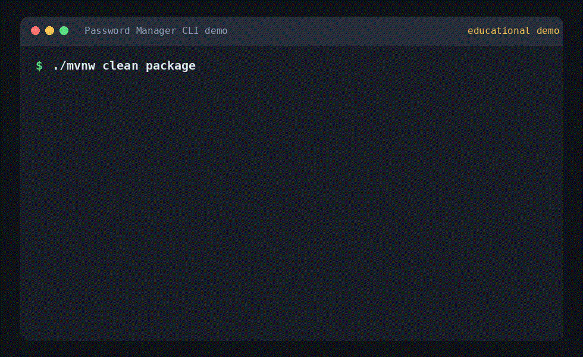

# Password Manager CLI

Edukacyjny lokalny zaszyfrowany vault haseł zbudowany w Javie 21. Projekt jest przygotowany pod portfolio: pokazuje warstwową architekturę, szyfrowanie uwierzytelnione, KDF, atomowy zapis plików i testowalne flow komend CLI.

> To projekt edukacyjny bez profesjonalnego audytu bezpieczeństwa. Nie jest zamiennikiem produkcyjnych menedżerów haseł. Używasz go na własną odpowiedzialność.

## Funkcje

- Lokalny zaszyfrowany vault JSON w `~/.passwordmanager/vault.json`.
- AES-256-GCM dla zaszyfrowanego payloadu vaulta.
- Argon2id do wyprowadzania klucza z hasła master.
- Dodawanie, listowanie, pokazywanie, aktualizacja i usuwanie wpisów.
- Generator haseł z konfigurowalną długością i klasami znaków.
- Eksport/import jawnego JSON do backupu albo migracji.
- Atomowy zapis vaulta i kopia `.bak` przed aktualizacją.
- Maven, JUnit, GitHub Actions, fat jar i skrypty uruchomieniowe.

## Instalacja i pierwszy start

Zainstaluj Javę 21 lub nowszą. Pobierz `passwordmanager-1.0.0.zip` i plik `.sha256` z [wydania v1.0.0](https://github.com/wikt0r2115/passwordmanager/releases/tag/v1.0.0), sprawdź sumę i rozpakuj archiwum. Paczka nie wymaga instalacji Mavena.

Linux:

```bash
sha256sum -c passwordmanager-1.0.0.zip.sha256
unzip passwordmanager-1.0.0.zip
./passwordmanager-1.0.0/passwordmanager.sh --help
./passwordmanager-1.0.0/passwordmanager.sh init
```

macOS: użyj `shasum -a 256 -c passwordmanager-1.0.0.zip.sha256`, a potem tych samych komend `unzip` i launchera. Windows PowerShell: porównaj `(Get-FileHash .\passwordmanager-1.0.0.zip -Algorithm SHA256).Hash.ToLower()` z sumą w `.sha256`, uruchom `Expand-Archive .\passwordmanager-1.0.0.zip`, a następnie `.\passwordmanager-1.0.0\passwordmanager.bat --help` i `init`.

CLI pyta o hasło master w prawdziwym terminalu. Budowa ze źródeł: `./mvnw clean package` (Windows: `.\mvnw.cmd clean package`), następnie launcher w katalogu repozytorium. Więcej w [instrukcji instalacji](docs/installation.md).

## Demo



Scenariusz demo w katalogu rozpakowanej paczki (na osobnym koncie testowym):

```bash
./passwordmanager.sh init
./passwordmanager.sh add --name github --username user@example.com --url https://github.com
./passwordmanager.sh list
./passwordmanager.sh update --name github --prompt-password
./passwordmanager.sh show --name github
```

Inicjalizacja vaulta:

```bash
./passwordmanager.sh init
```

Dodanie wpisu. Jeśli pominiesz `--password`, aplikacja zapyta o hasło wpisu bez wyświetlania go w terminalu:

```bash
./passwordmanager.sh add --name github --username user@example.com --url https://github.com
```

Dodanie wpisu z wygenerowanym hasłem:

```bash
./passwordmanager.sh add --name email --username user@example.com --generate --length 24
```

Listowanie i podgląd wpisu:

```bash
./passwordmanager.sh list
./passwordmanager.sh show --name github
```

Aktualizacja wpisu z promptem na nowe hasło:

```bash
./passwordmanager.sh update --name github --prompt-password
```

Eksport/import jawnego JSON:

```bash
./passwordmanager.sh export --output backup.json
./passwordmanager.sh import --input backup.json
```

Pliki eksportu są jawne i zawierają hasła. Traktuj je jak dane wrażliwe.

## Komendy

| Komenda | Opis |
| :--- | :--- |
| `init` | Inicjalizuje nowy zaszyfrowany vault. |
| `add` | Dodaje wpis. Domyślnie pyta o hasło wpisu, chyba że użyjesz `--password` albo `--generate`. |
| `list` | Listuje nazwy, użytkowników i URL-e bez pokazywania haseł. |
| `show` | Pokazuje pełne dane jednego wpisu, razem z hasłem. |
| `update` | Aktualizuje pola albo rotuje hasło przez `--generate` lub `--prompt-password`. |
| `remove` | Usuwa wpis po nazwie. |
| `export` | Eksportuje wpisy do jawnego JSON. |
| `import` | Scala wpisy z jawnego JSON, pomijając duplikaty po ID. |
| `generate` | Generuje samodzielne losowe hasło. |

## Bezpieczeństwo

- Hasło master jest czytane jako `char[]` i czyszczone po użyciu tam, gdzie pozwalają na to API Javy.
- Hasło wpisu można podać przez bezpieczniejszy prompt bez echo. Opcja `--password` nadal istnieje dla skryptów, ale może ujawnić hasło w historii shella albo liście procesów.
- Koperta vaulta jest walidowana przed KDF: format, wersja, Base64, długości soli/nonce oraz limity parametrów Argon2.
- AES-GCM AAD uwierzytelnia wybrane pola nagłówka: format, wersję, nazwę KDF, nazwę szyfru i długość tagu.
- Parametry KDF, sól i nonce są jawne, bo są potrzebne do odszyfrowania. Dane wpisów są tylko w zaszyfrowanym payloadzie.
- Komendy zapisujące trzymają wyłączną blokadę `vault.json.lock` od odczytu do zapisu. Druga komenda zapisująca kończy się kodem 1. Plik blokady może pozostać po wyjściu; nie usuwaj go, gdy komendy mogą działać. Odczyt w czasie zapisu widzi cały stary albo cały nowy vault.
- Pomyślna aktualizacja najpierw tworzy `vault.json.bak` z poprzedniej zaszyfrowanej wersji, potem atomowo podmienia vault. Błąd tworzenia kopii lub podmiany pozostawia poprzedni vault. Rób też osobne kopie: `.bak` zawiera tylko stan sprzed ostatniego pomyślnego zapisu.
- Lokalny CLI nie chroni przed malware, keyloggerami, screen capture ani uprzywilejowanym atakującym na tym samym komputerze.
- To projekt edukacyjny używany na własną odpowiedzialność.

## Odzyskiwanie

Zaszyfrowany vault jest w `~/.passwordmanager/vault.json` (Windows: `%USERPROFILE%\.passwordmanager\vault.json`). Po pomyślnej aktualizacji poprzednia zaszyfrowana wersja jest w `vault.json.bak` obok niego. Kopia też wymaga hasła master. Zatrzymaj wszystkie komendy programu, skopiuj oba pliki w inne miejsce, podmień uszkodzony vault kopią i sprawdź `list`. Linux/macOS:

```bash
cp ~/.passwordmanager/vault.json ~/.passwordmanager/vault.json.failed
cp ~/.passwordmanager/vault.json.bak ~/.passwordmanager/vault.json
./passwordmanager.sh list
```

Windows PowerShell: `Copy-Item "$HOME\.passwordmanager\vault.json" "$HOME\.passwordmanager\vault.json.failed"`, potem `Copy-Item "$HOME\.passwordmanager\vault.json.bak" "$HOME\.passwordmanager\vault.json"` i `passwordmanager.bat list`. Błędne hasło master, uszkodzony vault i nieudany import nie uruchamiają zapisu. `.bak` nie pomoże po utracie obu plików ani po zapomnieniu hasła master. Eksport jest **jawny** i zawiera hasła wpisów: twórz go tylko w razie potrzeby i przechowuj albo usuwaj ostrożnie.

## Development

Testy:

```bash
./mvnw test
```

Fat jar:

```bash
./mvnw clean package
java -jar target/passwordmanager-1.0.0.jar --help
```

## Stack

- Java 21
- Maven
- Maven Wrapper
- picocli
- Jackson
- Bouncy Castle Argon2id
- Java Cryptography Architecture AES-GCM
- JUnit 5

## Licencja

MIT. Szczegóły w [LICENSE](LICENSE).
